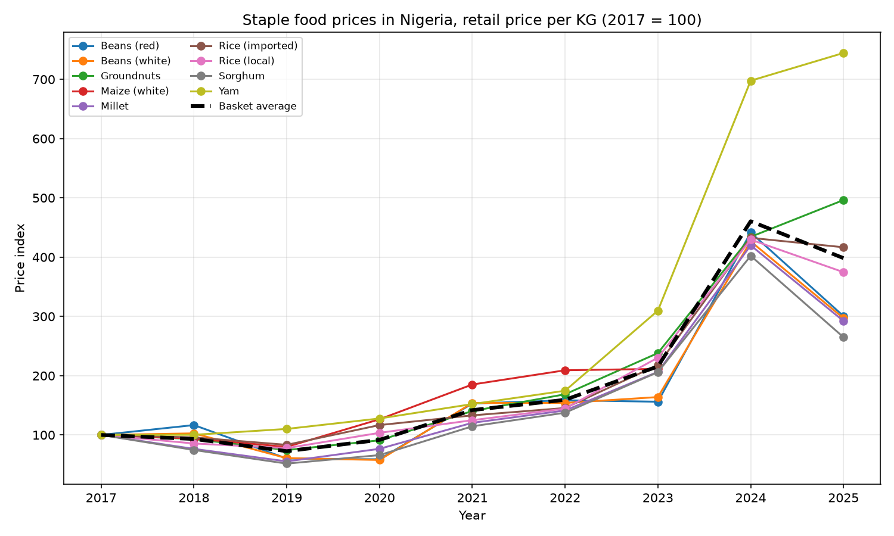
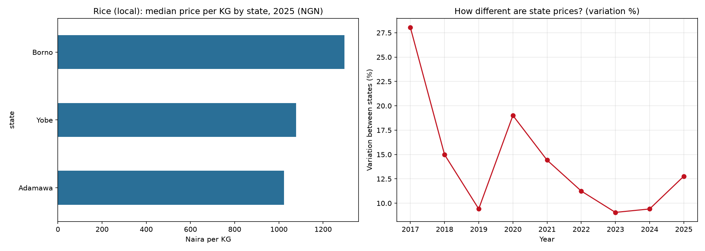
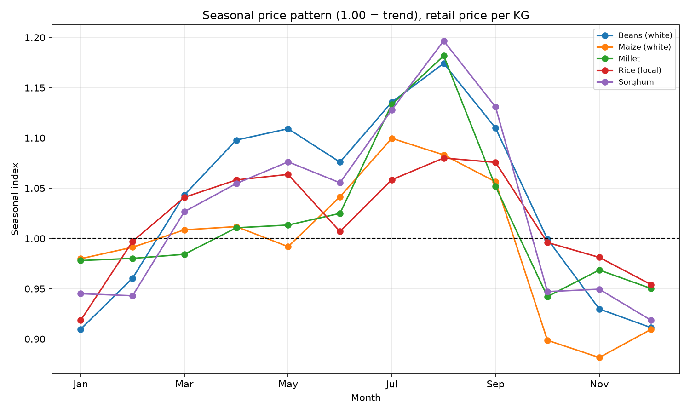

# Nigeria Food Price Analysis (2017–2025)

Exploratory data analysis of 88,545 food price records from the UN World Food Programme, covering 14 Nigerian states and 68 markets between 2002 and 2026. The analysis focuses on retail prices from 2017 to 2025, when data coverage is strongest.

## Questions
1. Which staple foods rose fastest in price, and how does that compare to the average?
2. Which states and markets are most expensive, and is the gap widening?
3. Do prices follow a seasonal pattern?

## Key findings       

1. **Prices rose sharply in Naira, but mostly fell in US dollars.** Between 2017 and 2025, retail prices per KG rose by 165% to 644% across eight staples, against a basket average of 298%. Yam rose fastest (+644%, from about 161 to 1,200 NGN/KG), followed by groundnuts (+396%) and imported rice (+317%). In US dollars, six of the eight staples became cheaper (down 16% to 47%) and groundnuts were flat, which points to the Naira's depreciation as the main driver. Yam was the exception (+60% in dollars).

2. **Lagos was the most expensive state for local rice in 2020–2022, and the gap between states did not keep widening.** In 2019–2022, when 11 to 13 states had enough data, the highest state price was 1.36 times the lowest in 2019, peaked at 1.95 times in 2020, and narrowed to 1.53 times by 2022. Since 2023 only three states have enough local-rice data. Among them, Borno was the most expensive in 2025 (about 1,296 NGN/KG, 27% above the cheapest of the three at 1,023 NGN/KG).

3. **Staple prices follow a clear seasonal pattern.** Averaged across five staples (white beans, white maize, millet, local rice and sorghum), prices run about 14% above trend in August and about 7% below trend in December. They rise from about March to an August peak, which is the pre-harvest lean season, then drop roughly 12% between September and October as harvest arrives. Four of the five staples peak in August; white maize peaks in July.

## Method
- Kept retail prices only (wholesale is a different market).
- Converted pack sizes ("2.7 KG", "100 KG") to price per 1 KG so they are comparable. Rows in units that cannot convert (e.g. "100 Tubers") were dropped.
- Analyzed 2017–2025: earlier years have too few records, and 2026 is partial.
- Used medians, which resist outliers.
- Price growth is compared against a basket benchmark (the average of the staples analyzed), and also in US dollars using WFP's own conversion.
- State comparison only includes states with at least 6 price records in that year.
- Seasonality: divided each month's price by a 12-month moving-average trend (on log prices) to separate seasonal swings from inflation.

## Limitations
- Only 14 states are covered, so this is not a national picture. Prices come from WFP-monitored markets.
- The state comparison for local rice is only reliable for 2019–2022. In 2017–2018 and 2023–2025, only 2 to 3 states had enough data.
- White maize has no 2025 price-per-KG data after filtering, so it is left out of the price growth comparison.
- Yam's change may be affected by shifts in the market and unit mix over time.
- No official inflation series was used. The benchmark is the average of the staples analyzed.

## Run it
Install the libraries with `pip install -r requirements.txt`. Download the raw WFP file (link below), update the file path at the top of `02_cleaned.py`, then run scripts `02_cleaned.py`, `04_prepare.py`, `05_q1_price_growth.py`, `06_q2_states_markets.py` and `07_q3_seasonality.py` in order. Charts and tables are saved to the `outputs` folder.

## Data
World Food Programme food prices for Nigeria, via the Humanitarian Data Exchange: https://data.humdata.org/dataset/wfp-food-prices-for-nigeria (check the license on that page).

## Tools
Python, pandas, NumPy, Matplotlib, VS Code